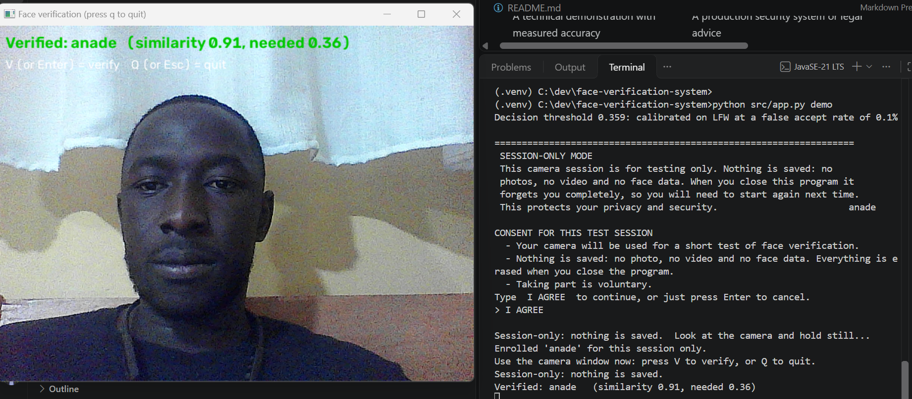
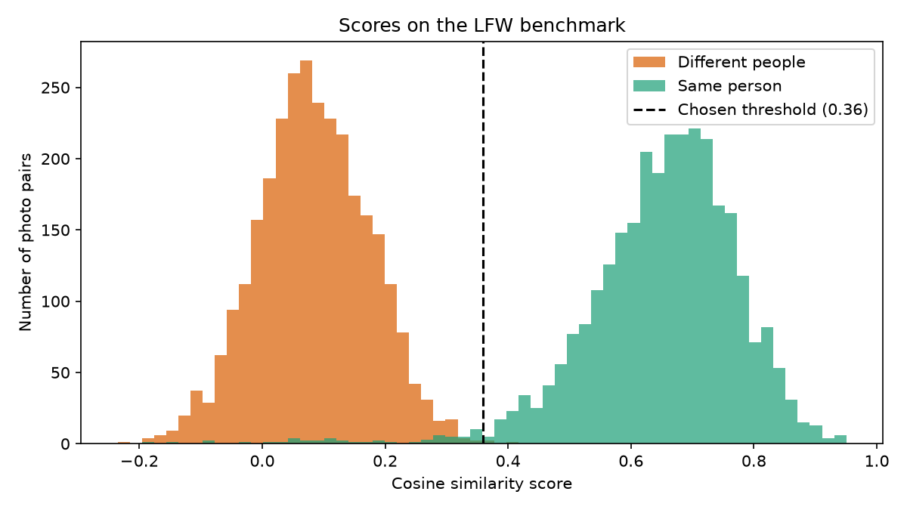
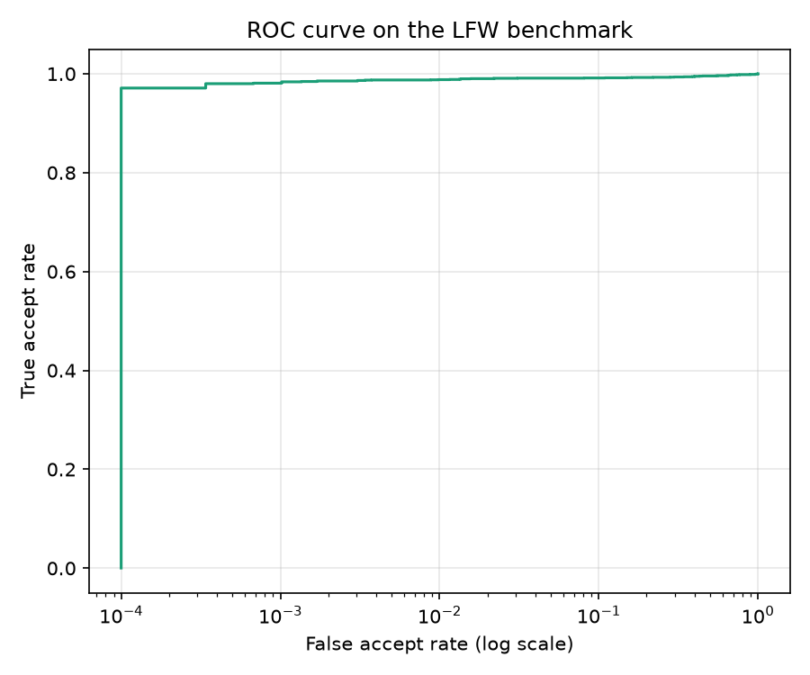

# Consent-Based Face Verification System

> A Python and OpenCV project that checks whether a person is who they claim to be (one-to-one verification), built around explicit consent, no stored photos, encrypted templates that expire, a session-only mode, and honestly reported accuracy.

**Status:** Built and tested. Accuracy is measured on the LFW benchmark (below). A small test with consenting volunteers is planned.



## What it is, and what it is not

| It is | It is not |
|---|---|
| One-to-one verification: "is this the person who enrolled?" | One-to-many identification: searching a crowd or database for who someone is |
| Opt-in: nothing is captured until the person has typed an agreement | Covert, passive or automatic capture |
| A technical demonstration with measured accuracy | A production security system or legal advice |

## Privacy and ethics by design

| Principle | Implementation |
|---|---|
| Explicit consent first | The exact phrase `I AGREE` must be typed before the camera opens. The consent version and time are stored with the template |
| Data minimisation | No photo or video is ever written to disk. Only a 128-number template is kept, built from several frames |
| Encryption at rest | Templates are encrypted and sealed against tampering (Fernet: AES plus HMAC). The key lives in `.env`, which Git ignores |
| Retention and deletion | Templates expire (90 days by default), expired ones are deleted on use, and `delete` removes a person's data on request |
| Session-only mode | The `demo` command keeps everything in memory and erases it when the program ends: nothing is saved |
| Safe test data | Only the author's own face and volunteers who consent. No faces are scraped from the web or social media |
| No public live camera demo | A hosted camera app would collect strangers' biometric data, so the demo runs locally |

## Using it

```powershell
python src/app.py demo               # session-only: enroll, verify, and everything is erased at the end
python src/app.py enroll anade       # save an encrypted template (asks for consent first)
python src/app.py verify anade       # compare the camera with that template: Verified or Not verified
python src/app.py list               # who is enrolled, and when it expires
python src/app.py delete anade       # remove a template
python src/app.py purge              # remove every expired template
```

The preview window stays on the local screen and nothing from it is recorded. In the demo the camera window is the control panel: press `V` (or Enter or Space) to verify and `Q` (or Esc) to quit. The camera is switched on only after consent has been given.

**Session-only mode shows this notice before the camera opens:**

> **SESSION-ONLY MODE.** This camera session is for testing only. Nothing is saved: no photos, no video and no face data. When you close this program it forgets you completely, so you will need to start again next time. This protects your privacy and security.

## Models and licences

| Model | Task | Licence | SHA-256 fingerprint of the file used |
|---|---|---|---|
| YuNet (`face_detection_yunet_2026may.onnx`) | Face detection | MIT | `ebafce4e3c118d6554634be5c27ab333b4c047a9a8c3faf1d7cf93101c22f0f0` |
| SFace (`face_recognition_sface_2021dec.onnx`) | Face recognition (128-number embeddings) | Apache 2.0 | `0ba9fbfa01b5270c96627c4ef784da859931e02f04419c829e83484087c34e79` |

Both come from the OpenCV Zoo. **Provenance note:** OpenCV does not document what the released SFace model was trained on. The SFace paper used large research face datasets (CASIA-WebFace, VGGFace2 and MS1M). This project cannot verify the consent status of those images, and the licence above covers the model files only.

## Evaluation

- **Benchmark:** the standard Labeled Faces in the Wild (LFW) pair protocol: 6,000 photo pairs in 10 folds, scored locally. The images are never committed or redistributed.
- **Metrics:** false accept rate (FAR), false reject rate (FRR), equal error rate (EER), the ROC (Receiver Operating Characteristic) curve, and accuracy under the standard protocol. Thresholds are chosen on nine folds and measured on the tenth.
- **Decision threshold:** set so that at most 0.1% of different-person pairs are accepted, then used by the program.
- **Honest ranges:** error rates are reported with 95% confidence ranges. With 3,000 different-person pairs the smallest measurable false accept rate is about 0.03%, so no "one in a million" claim can be made from this test.
- **Caveat:** LFW consists of web-collected photos of public figures and is skewed in who it includes. High scores overstate real-world accuracy, especially across demographic groups. LFW has also been described as an ethically problematic dataset in published research, which is why it is used for evaluation only.

```powershell
python src/download_lfw.py        # downloads and verifies the benchmark
python src/02_evaluate_lfw.py     # scores the pairs, writes reports/ (anonymous totals and charts)
```

### Results

Run on the standard LFW protocol: 6,000 photo pairs (3,000 same person, 3,000 different people) from 7,701 photos.

| Measure | Result |
|---|---|
| Accuracy (threshold chosen on 9 folds, measured on the 10th) | **99.10%** (± 0.48%) |
| Equal error rate (EER) | **1.16%** |
| Deployed threshold (cosine similarity) | 0.359, chosen so at most 0.1% of different-person pairs are accepted |
| False accept rate (FAR) at that threshold | **0.068%** (2 of 2,944 pairs; 95% range 0.019% to 0.247%) |
| False reject rate (FRR) at that threshold | **1.90%** (56 of 2,941 pairs; 95% range 1.47% to 2.46%) |
| Held-out, target FAR 1% | FAR 1.02% (± 0.68%), FRR 1.23% (± 0.65%) |
| Held-out, target FAR 0.1% | FAR 0.10% (± 0.23%), FRR 1.81% (± 1.10%) |

**Detection failures are counted honestly.** No face was found in 70 of 7,701 photos (0.9%), so 115 of the 6,000 pairs could not be scored (59 same-person, 56 different-person). The figures above cover the 5,885 scored pairs. A same-person pair with no detectable face can never be verified, so counting those as rejections, the end-to-end false reject rate is **3.83%** (115 of 3,000). The false accept rate is unaffected, because a pair with no face cannot be falsely accepted.

**How to read these numbers.** With 2,944 different-person pairs, the smallest measurable false accept rate is about 0.034%, and the observed 2 false accepts give a wide range. These are results on one public benchmark. They do not show how the system behaves for every group of people, and they do not show resistance to spoofing.

| Score distributions | ROC curve |
|---|---|
|  |  |

Huang, G. B., Ramesh, M., Berg, T., & Learned-Miller, E. (2007). *Labeled Faces in the Wild: A Database for Studying Face Recognition in Unconstrained Environments.* University of Massachusetts, Amherst, Technical Report 07-49.

## Limitations

- **No liveness detection.** A printed photo or a video of the person could fool it. It is a demonstration, not an anti-spoofing system.
- A template is not anonymous: research shows embeddings can sometimes be partly reversed, so templates are treated as sensitive and encrypted.
- The key is stored next to the data, which is acceptable for a demonstration. A real deployment would keep it in a key vault.
- The decision threshold is calibrated on single benchmark photos, while the program compares an averaged template with several camera frames, so behaviour on a real camera needs its own small test.
- File deletion on solid-state drives cannot guarantee that the old bits are physically erased. Deleting the key is the stronger erase.

## Legal note

This is a technical demonstration, not legal advice. Anyone deploying face verification needs their own legal review and a data protection impact assessment. In general terms:

- **Kenya:** biometric data is classed as sensitive personal data under the Data Protection Act 2019, and the Data Protection Commissioner has issued guidance on biometric data.
- **European Union:** the GDPR (General Data Protection Regulation) restricts processing biometric data to uniquely identify a person unless an exception applies, such as explicit consent.
- **Illinois (USA):** the Biometric Information Privacy Act requires notice, a written release before collection, and a public retention and destruction policy.

## Roadmap

- [x] Project setup, licence and environment check
- [x] Encrypted template storage with expiry and deletion (covered by automated tests)
- [x] Consent step and session-only mode (covered by automated tests)
- [x] Live camera enrollment and verification, tested on the author's face
- [x] Accuracy evaluation on LFW
- [x] Technical reference
- [ ] Small consented test with volunteers (consent form in `docs/`)
- [ ] Stretch: a simple liveness challenge, and an in-browser demo that never uploads an image

## Quick start

```powershell
python -m venv .venv
.\.venv\Scripts\Activate.ps1
pip install opencv-python numpy cryptography matplotlib pytest
python src/download_models.py
python src/01_check_setup.py
pytest
python src/app.py demo
```

## Documentation

- [Technical reference](docs/technical-reference/face-verification-reference.md): design, privacy controls, evaluation method, testing and common pitfalls
- [Glossary of abbreviations](docs/glossary.md)
- [Volunteer consent form (template)](docs/volunteer-consent-form.md)

## License and attribution

Released under the [MIT License](LICENSE). Reuse is welcome, and the license requires that the copyright notice stays with any copy or substantial portion of this work. Please credit it as:

> Anade A'Acharo, *Consent-Based Face Verification System*, https://github.com/AAchar-0/face-verification-system

Presenting this work as your own, or removing the notice, is not permitted by the license.
